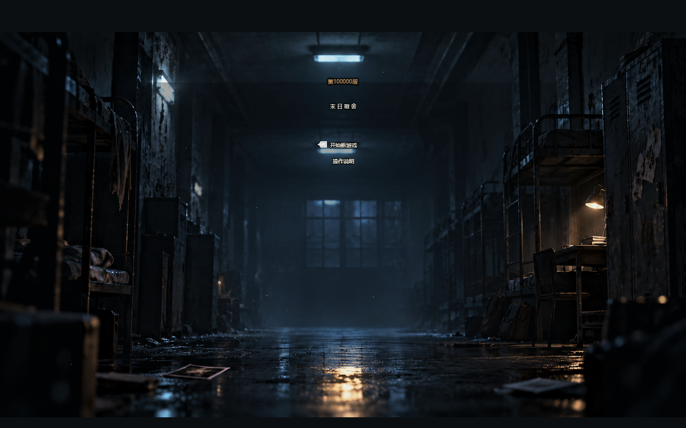
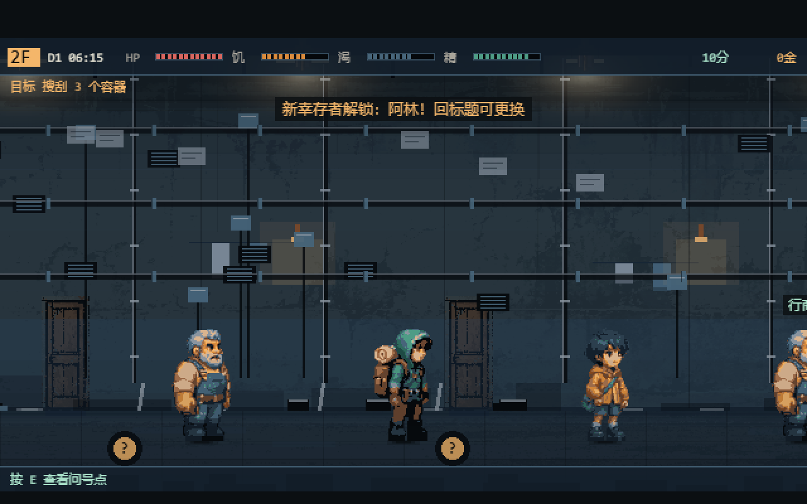
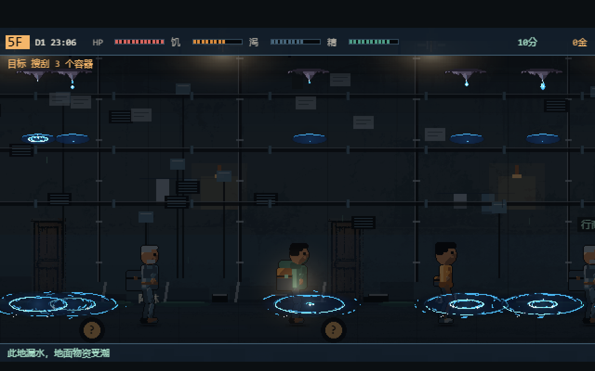
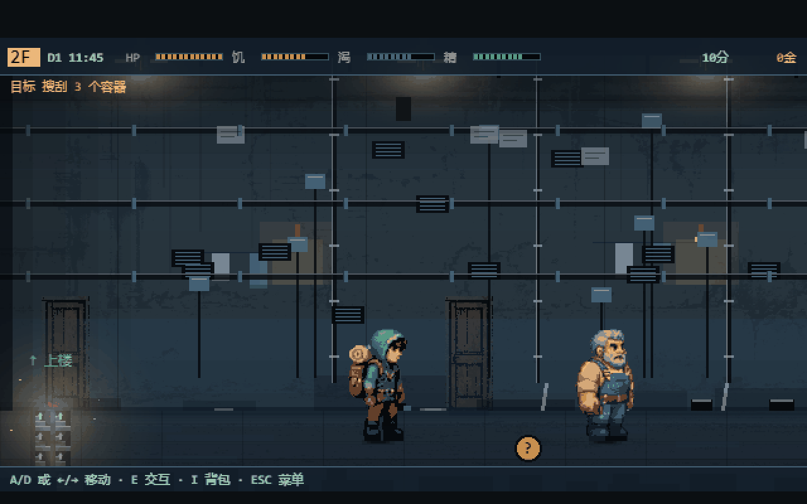
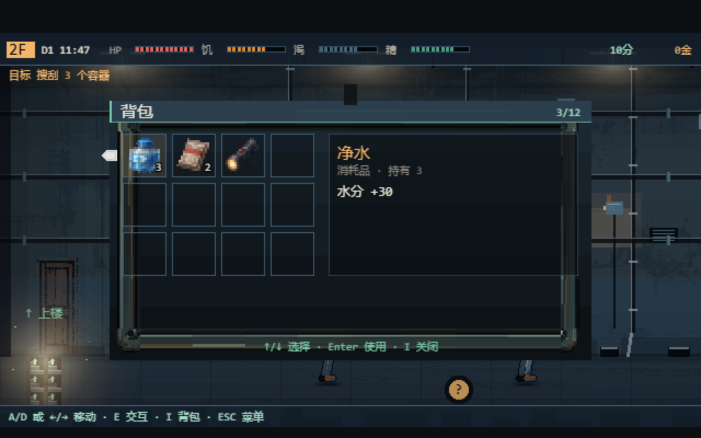
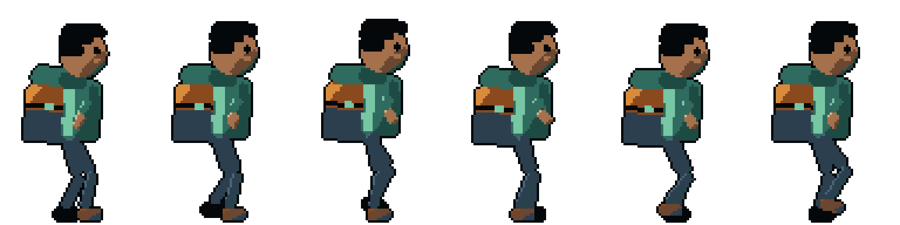
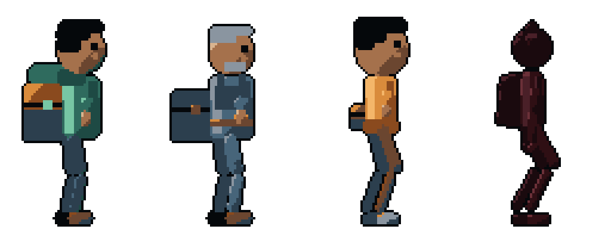

# 第100000层：末日宿舍

> 2D 横版像素生存游戏。在一座看不见底的十万层末日宿舍塔里，你从最底层的一张床醒来，靠探索楼层、搜刮物资、与邻居交易活下去，然后一路向上——直到有机会决定整座塔的命运。

技术栈：**Phaser 4.2.1** + **TypeScript（strict）** + **Vite**；单测 **Vitest**，浏览器 E2E **Playwright**，桌面版 **Electron**。核心规则是可测试的纯 TypeScript，Phaser 只负责渲染与输入。

---

## 游戏画面




<details>
<summary>更多截图：选人、二楼邻居、食堂火盆、漏水、搜刮、背包</summary>

| 选人 | 二楼：三个角色同屏 |
| --- | --- |
|  |  |

| 食堂：火盆在烧 | 漏水：天花板在滴水 |
| --- | --- |
|  |  |

| 搜刮容器 | 背包 |
| --- | --- |
|  |  |
</details>

## 这个游戏是什么

不是「宿舍版横版冒险」，也不是模拟经营。它是**巨型塔楼探索 × 近景生存 × 宿舍基地建设 × 阶级与权力**。

一昼夜的循环：

```
06:00 醒来 → 看补给与状态 → 决定今天上到第几层
      → 走路 / 搜刮容器 / 开问号点 / 打遭遇战 / 和邻居做交易
      → 东西装不下就得取舍，天黑前赶回宿舍
      → 喝水、吃饭、在工作台制作、升级家具
      → 20:00 后睡觉 → 新一天，资源更紧，目标重 roll
```

- **起点**：第 1 层，最底层的贫民宿舍。
- **终点**：第 100000 层，统治核心。正式版本的胜利条件是**抵达塔顶**，不是熬到某一天。
- **失败**：生命归零。死因可解释（脱水 / 饥饿 / 伤势）。
- **当前可玩范围**：第 1–5 层，构成第一个完整生存章节。

## 角色与动画

四个可操作角色全部由**代码骨架（rig）驱动**，不是逐帧手绘：一份 SVG 骨架定义骨骼与配色，一份 `rig_anim.v1` JSON 定义关键帧与两骨 IK，工具负责渲染、落地检查与打包。所以脚步不会打滑——着地那只脚在世界坐标里恒定，接触报告量出 **0.0px 漂移**。





每个角色 20 帧、7 段动画：行走（6）· 待机（2）· 攻击（3）· 受击（2）· 搜刮（2）· 死亡（3）· 拾取（2）。骨架文件在 [`art-src/rigs/`](art-src/rigs/)，装配工具是 [`tools/assemble-rig-sheet.py`](tools/assemble-rig-sheet.py)。

| 角色 | 识别特征 |
| --- | --- |
| **幸存者** | 青绿连帽衫，大帆布背包（铺盖卷 + 压缩带） |
| **阿林** | 宽肩、灰白短须、钢蓝背带裤，腰上挂着扳手 |
| **小周** | 约十二岁：头大身窄，琥珀色大外套长过臀 |
| **流浪者** | 夜里追你的东西：尖顶兜帽、没有脸、窄身长手长腿，5 色暗红黑 |

---

## 当前状态（2026-11-18，对应集成线 tip `cc3059c`）

本仓库的权威状态以集成线 `integrate/sprint-01-merge` 的 tip **`cc3059c`** 为准；本文所有数字均在文档分支 `rc/2026-11-18-docs-status`（tip 同为 `cc3059c`）上**实跑取得**。项目纪律：**代码实现 / 场景接线 / 实际验收是三个不同的状态**——「代码里有」不等于「接进场景」，更不等于「验收通过」。B4–B6 的三态拆解见 [`docs/ROADMAP.md`](docs/ROADMAP.md)。

### 质量门禁实况（2026-11-18 实跑）

| 关卡 | 实况 |
| --- | --- |
| 类型检查 | `tsc --noEmit` **0 错** |
| 单元测试 | **116 个文件 / 2096 个用例全部通过**（`VITE_NPC_MODEL= npx vitest run`） |
| 生产构建 | **通过**（`tsc && vite build` → `dist/`） |
| 浏览器 E2E | **观测项，非合并门禁**：磁盘上 56 个 Playwright spec；RC-01 重新验收进行中，通过数字由 E2E 工作线回填，本文不写死 |

> E2E 套件驱动真实 Phaser 帧循环，剩余抖动是帧时序而非逻辑错误，已降为观测项；确定性门禁是 typecheck + 全部单测 + build。

### 怎么跑起来

- **浏览器开发**：Node.js 20+，`npm install` → `npm run dev`，按终端提示打开 http://localhost:5173。
- **生产构建**：`npm run build`（先 `tsc` 再 `vite build`，输出纯静态站点 `dist/`）；`npm run preview` 本地预览。
- **桌面版（Electron）**：桌面壳是**自包含子项目** [`electron/`](electron/README.md)（自己的 `package.json` / `node_modules`，不改主工程文件）。开发：根目录 `npx vite --port 5377 --strictPort`，另开终端 `cd electron && npm start`。打包：根目录先 `npm run build`，再 `cd electron && npm install && npx install-electron`（只需一次），然后 `npx electron-builder --dir` 出可分发目录，或 `npm run dist:win` 出安装器。
- **AI NPC**：默认关闭（安全设计），发行版不带任何 AI 配置，行为与纯规则版一致。配置方式与降级行为见 [`docs/AI_NPC_CONFIG.md`](docs/AI_NPC_CONFIG.md)。

### 塔楼现状

54 个手工楼层分布在 5 个阶层区段（1–10 / 100–110 / 1000–1010 / 10000–10010 / 50000–50010），其余楼层由确定性世界生成按需合成（同种子同结果，`src/core/worldgen.ts`）；第 100000 层是终局场景，不是出生点。

## 现在做到哪了

| 里程碑 | 内容 | 状态 |
| --- | --- | --- |
| **M1 可玩原型** | B2 + B3：五层范围内探索、搜集、制作、交易、睡觉、存档，无软锁 | 🔵 机制层已完成，**待人工试玩判定「好不好玩」** |
| **M2 首个完整章节** | B4 + B5 + B6：世界生成、资源经济、NPC 关系 | 🟡 必要子集已有代码实现与场景接线，未验收（三态拆解见 [`docs/ROADMAP.md`](docs/ROADMAP.md)） |
| **M3 正式游戏** | B7–B10：阶级与权力、多路线终局、内容与发行 | ⬜ 未开始 |

| 阶段 | 一句话 | 状态 |
| --- | --- | --- |
| B2 塔楼世界与导航 | 十万层可查看、可规划、不可乱传 | ✅ 已实现，待验收 |
| B3 首个完整生存章节 | 第 1–5 层能玩完一段完整循环 | 🔵 进行中 |
| B4 十万层世界生成 | 100 个区段可复现、按需生成 | 🟡 代码在 + 场景已接线；未验收 |
| B5 资源经济与基地建设 | 同一物资兼具生存价值与经济价值 | 🟡 代码在 + 场景已接线；未验收 |
| B6 NPC 与关系网络 | 居民有身份、需求和记忆 | 🟡 代码在 + 场景已接线；未验收 |
| B7–B10 | 阶级与权力、多路线终局、内容、发行 | ⬜ |

已知的两个待解问题（不是 bug，是内容量问题）：**一天里仍有约 8 小时无事可做**；**五层内容是一次性的**，回取一趟之后再无上楼理由。详见 [`docs/M1_PLAYTEST.md`](docs/M1_PLAYTEST.md)。

## 玩法系统

39 个纯逻辑模块都在 `src/systems/`，一行 Phaser 代码都没有——所以能毫秒级跑测试。

| 系统 | 玩家看到什么 | 模块 |
| --- | --- | --- |
| **生存** | 饥饿 / 口渴 / 精力三条槽随时间下降，归零掉血 | `SurvivalSystem` |
| **时间** | 时钟 1 真实秒 = 3 游戏分钟；搜刮、制作、交易各花 20/30/15 游戏分钟 | `SurvivalSystem` |
| **背包** | 12 格，装满会常驻警告，可合并的堆才能进包 | `InventorySystem` |
| **搜刮** | 容器与地面物品，掉落按种子决定，关键道具保底 | `LootSystem`、`data/floorTemplates` |
| **制作** | 在宿舍工作台旁按配方造物品、升级家具 | `CraftingSystem` |
| **交易** | 跟邻居以物易物，守价守恒 | `TradeSystem` |
| **遭遇** | 问号点：战利品 / 伏击 / 商人 / 便条 / 补给箱 / 守门人 | `encounters`、`encounterSpots` |
| **战斗** | 回合制，攻击 / 防御 / 逃跑；15 种怪 7 种行为 | `combat`、`monsters` |
| **每日目标** | 每天 06:00 roll 一个（补水 / 搜刮 / 建造 / 爬楼），完成给分和口粮 | `dailyGoals` |
| **停留压力** | 在同一层待越久，出现的客人越不友好 | `dwellPressure` |
| **遗物与模式** | 5 件按深度解锁的遗物；3 档难度（快速跑 / 冒险 / 简单） | `relics`、`modes` |
| **存档** | 自动存到 LocalStorage，坏档可恢复 | `SaveSystem` |
| **世界标记** | 「这事发生过吗」统一走一张 flag 表 | `WorldFlags` |
| **行商与跳层** | 第 2 层起每层过半一名确定性商人，金币买/卖；梯口按 CENTUM 公式付费跳 2–4 层，越用越贵 | `shop`、`shortcut` |
| **战斗表现** | 4 角色 × 6 动作 GIF 图集全量接线；震屏 / 顿帧 / 受击闪白 / squash / 伤害数字三档打击感（可关震屏） | `combat`、`render/` |
| **成就** | 14 条跨局永久成就（深度六连 / 制作 / 生存 / 搜刮战斗 / 交际），预留 Steamworks API 名 | `AchievementSystem` |
| **统计与纪录** | 本局 13 项统计随存档累计 + 跨局纪录，结算画面高亮破纪录项 | `StatsSystem` |
| **音频** | BGM 五轨（菜单 / 楼层 / 战斗 / 夜晚 / 电台）Web Audio 程序化合成 + 音效层；发行包零音频文件 | `AudioSystem`、`render/audio.ts` |
| **NPC 与 AI** | 人格原型 / 有界记忆 / 日程赶路 / 声誉易物；AI 大脑**默认关闭**，未配置时降级为选项树 | `NpcRuntime`、`NpcMemory`、`ai/` |
| **次级系统** | 日记、环境、士气、病痛、庇护所防御、教程、设置、元进度 | `DiarySystem`、`EnvironmentSystem`、`MoraleSystem`、`SicknessSystem` 等 |

## 技术架构

七层，越往下越不认识 Phaser：

| 层 | 职责 | 体量（2026-11-18 实计） |
| --- | --- | ---: |
| `scenes/` | 场景、输入、面板、动画调度（GameScene.ts 一体量 10,446 行，已知技术债，RC-01 审查项） | 16,076 行 |
| `render/` | 像素美术生成、行走循环、光照、音效合成、UI 组件 | 8,703 行 |
| `systems/` | 游戏规则，纯函数，只吃 `GameState`（39 个模块） | 9,924 行 |
| `data/` + `config/` | 物品、配方、楼层模板、NPC、人格原型、成就、平衡数值 | 6,549 行 |
| `core/` | 状态结构、时钟、常量、seeded RNG、世界生成、塔楼模型、存档序列化 | 2,610 行 |
| `ai/` | AI NPC：配置、人格、记忆、日程、大脑、规则执行器（**默认关闭**，见配置文档） | 1,749 行 |
| `tests/` | 单元测试（`src/tests/` + 伴生 `.test.ts`），**仍比场景代码多** | 29,024 行 |

三条刻意的技术决定：

1. **规则与渲染彻底分开**：`systems/` 不 import Phaser，2096 个单测用例无需浏览器也能独立运行。
2. **随机必须可复现**：全项目禁用 `Math.random()`，一律用 `deriveSeed(seed, day, 用途)` 派生。同种子必然同结果。
3. **不用物理引擎**：连 Phaser 自带的 Arcade Physics 都没开。移动是手写的速度斜坡（`stepHorizontalSpeed`），2D 横版不需要刚体。

## 质量与测试

| 关卡 | 规模 | 命令 |
| --- | --- | --- |
| 类型检查 | TypeScript strict，零 `any` 滥用；集成线 tip `cc3059c` 实跑 0 错 | `npm run typecheck` |
| 单元测试 | **116 个文件 / 2096 个用例，全部通过**（2026-11-18 实跑 `VITE_NPC_MODEL= npx vitest run`，非手抄） | `npm run test` |
| 浏览器测试 | 磁盘上 56 个 Playwright spec（夹具回归 + 真实输入旅程）；**状态为观测项**：RC-01 重新验收进行中，通过数字由 E2E 工作线回填，此处不写死 | `npm run test:e2e` |
| CI | push / PR 运行 typecheck、单测、build、浏览器安装及 E2E | `.github/workflows/ci.yml` |

浏览器测试能读到真实的游戏状态，靠的是 `src/main.ts` 里一个只在开发模式挂载的 `window.__PHASER_GAME__`——生产构建里没有。

部分 E2E 会改写状态作为局部规则夹具，不能代替无注入的真实旅程，更不能代替真人试玩。M1 当前集成结论见[集成审查](docs/M1_INTEGRATION_REVIEW.md)；三名试玩者的空白记录表见[真人试玩协议](docs/M1_PLAYTEST_PROTOCOL.md)。未通过集成门槛的构建不应标为已验收候选版。

## 本地运行（干净环境）

需要 Node.js 20+。

```bash
npm install
npm run dev
```

然后按终端提示打开浏览器（默认 http://localhost:5173）。干净环境不配任何 AI 变量，AI NPC 保持默认关闭——这是安全设计，不是缺失功能，配置方法见 [`docs/AI_NPC_CONFIG.md`](docs/AI_NPC_CONFIG.md)。

## 可用脚本

| 命令 | 作用 |
| --- | --- |
| `npm run dev` | 启动开发服务器 |
| `npm run typecheck` | TypeScript 严格类型检查（`tsc --noEmit`） |
| `npm run test` | Vitest 单元测试（纯逻辑：生存、制作、交易、存档、RNG 等） |
| `npm run build` | 类型检查 + 生产构建，输出到 `dist/` |
| `npm run preview` | 本地预览生产构建 |
| `npm run test:e2e` | Playwright 浏览器端到端测试（Chromium） |
| `npm run electron` | 以桌面窗口运行（需先 `build`） |
| `npm run dist:win` | 打包 Windows 可执行版 |

## 操作

- **A / D** 或 **← / →**：左右移动
- **E**：交互（开容器、对话、上下楼、在宿舍床边睡觉）
- **I**：背包（← → 选择，Enter 使用消耗品）
- **C**：制作台（在宿舍工作台旁）
- **ESC**：暂停菜单（继续 / 重新开始 / 返回标题）

生存的关键节奏：口渴掉得比饥饿快（每小时 3 点 vs 2 点），睡一觉也会消耗（按静息代谢减半计）。所以**天黑前回家**不只是躲巡游体，也是在省第二天的水。

## 存档与种子

- 存档保存在浏览器 LocalStorage（key：`floor100000.save.v1`），睡觉、切楼、制作/交易后自动保存；坏档会提示并可开始新游戏。
- 复现测试：在网址后加 `?seed=42` 可用固定种子开跑（QA 固定种子：1 / 42 / 2026）。
- 开发夹具：`?devfloor=` 直达指定楼层，`?devwin=1` 打开已废弃的旧胜利条件。两者都只在开发模式生效。

## 目录结构

```
src/
  main.ts            入口（含开发模式下的 E2E 状态钩子）
  scenes/            Boot / Menu / MetaSelect / Game / TowerOverview / End / QuestPanel
  core/              GameState、类型、常量、seeded RNG、世界生成、塔楼模型、存档序列化
  systems/           39 个纯逻辑模块（生存、战斗、遭遇、交易、经济、NPC、成就、统计、音频…）
  render/            像素美术生成、行走循环、光照、音效合成、UI 组件
  data/              物品表、配方、楼层模板、NPC、人格原型、成就
  ai/                AI NPC：配置、人格、记忆、日程、大脑、规则执行器（默认关闭）
  tests/             单元测试（含多日生存可行性模拟）
config/              平衡参数（game-balance.json）
electron/            Electron 桌面壳子项目（自包含，见该目录 README）
art-src/rigs/        角色与道具的代码骨架（SVG）+ 动画关键帧（JSON）
tools/               美术流水线：骨架装配、切片、素材报表
e2e/                 Playwright 浏览器测试与截图
素材库/              美术设定集 + 收集素材库（见该目录 README）
docs/                设计、路线图、任务、验收与各阶段报告
```

## 文档索引

入口是这三份，顺序不能反：

| 文档 | 作用 |
| --- | --- |
| [`docs/GAME_DESIGN_LOCK.md`](docs/GAME_DESIGN_LOCK.md) | **核心玩法设计冻结，最高权威**。与其它文档冲突时以它为准 |
| [`docs/ROADMAP.md`](docs/ROADMAP.md) | 里程碑、阶段拆解、验收标准 |
| [`docs/03_TASKS.md`](docs/03_TASKS.md) | 任务编号与完成状态 |

其他常看的：

| 文档 | 内容 |
| --- | --- |
| [`docs/01_GDD.md`](docs/01_GDD.md) | 早期设计基线（部分已被冻结文档取代，保留作历史） |
| [`docs/02_TECH_SPEC.md`](docs/02_TECH_SPEC.md) | 技术规格 |
| [`docs/M1_PLAYTEST.md`](docs/M1_PLAYTEST.md) | 自动试玩实测：时间预算、背包压力、空闲窗口 |
| [`docs/OVERNIGHT_FINAL.md`](docs/OVERNIGHT_FINAL.md) | 一个通宵把战斗/遗物/经济补齐的作战与结果 |
| [`docs/AI_NPC_CONFIG.md`](docs/AI_NPC_CONFIG.md) | AI NPC 配置方式：默认关闭原因、环境变量、降级行为 |
| [`CLAUDE.md`](CLAUDE.md) | 开发 Agent 的长期约束（流程、质量门槛、范围边界） |

## 素材与授权

- **美术设定集**：[`素材库/`](素材库/README.md) —— 已做进游戏的美术、待做方向的参考、素材从哪来、以及现在的缺口清单。**它不是运行目录**，游戏读的是 `public/assets/`。
- **授权台账**：[`THIRD_PARTY_NOTICES.md`](THIRD_PARTY_NOTICES.md)。目前含两笔：Kenney 的 CC0 选择箭头（`public/assets/ui/marker.png`），以及项目负责人提供的美术包（`public/assets/artpack/`，物品图标 / 角色立绘 / 家具 / 横幅）。
- 其余美术为**程序化生成或代码绘制**；音效全部由 Web Audio 在运行时合成，**构建产物里没有任何音频文件**。
- 角色骨架、动画与装配工具均为本项目代码生成（code-drawn，无图像模型参与）。渲染器与素材报表工具来自 `agent-sprite-forge`，其源码按各自许可单独存放，**不进入本仓库**。

## 部署

`npm run build` 生成纯静态站点（`dist/`），可部署到任意静态托管。**公开部署需项目负责人另行许可**，不得默认推送到线上服务。

## 桌面版（Electron）

打包成 Windows 可执行版本：

```bash
npm run build       # 先构建 dist/
npm run dist:win    # 输出 release/Floor100000-win32-x64/Floor100000.exe
```

以桌面窗口直接运行（需先 `npm run build`）：`npm run electron`。打包使用本机已缓存的 Electron，无需联网下载。
