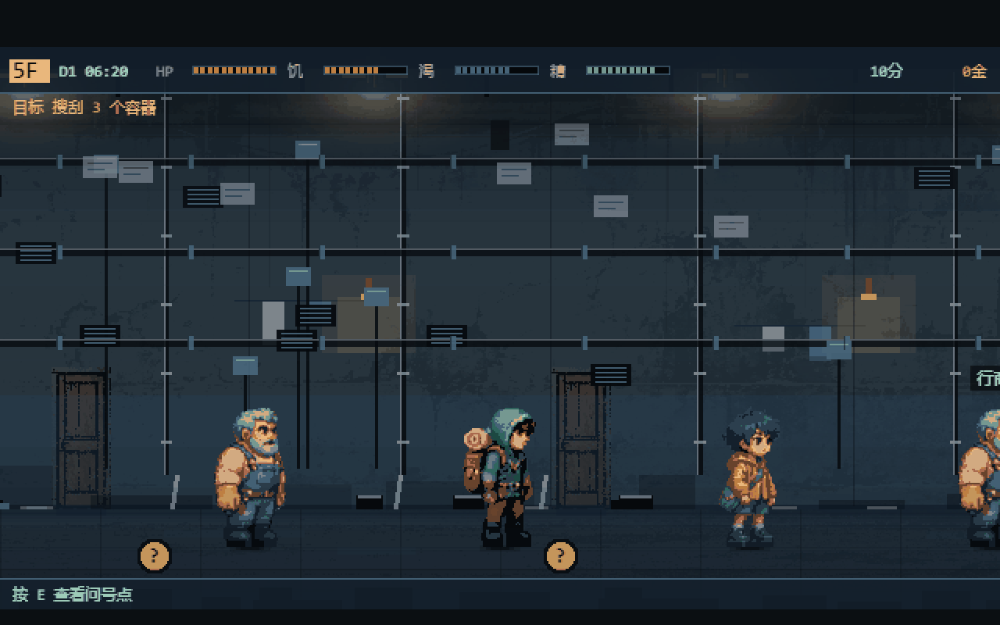
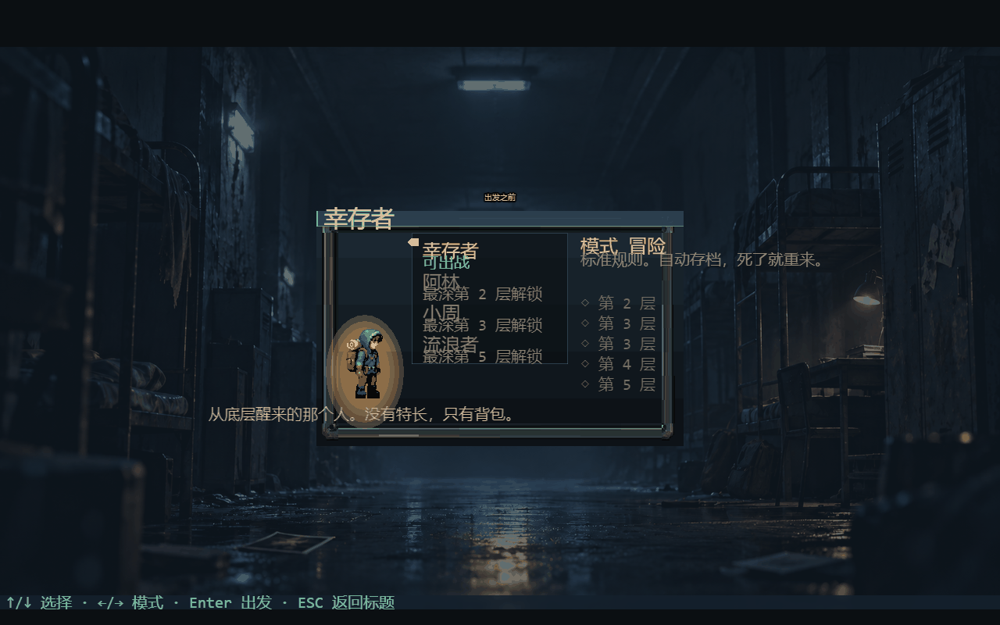
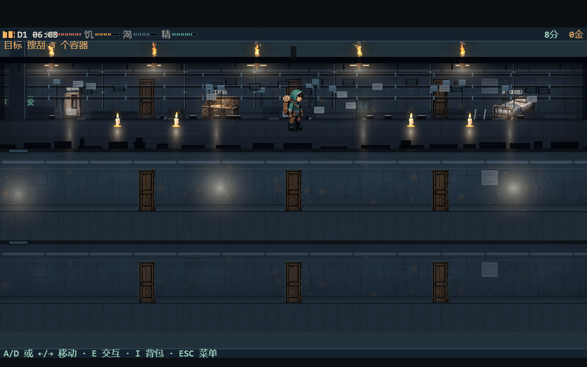
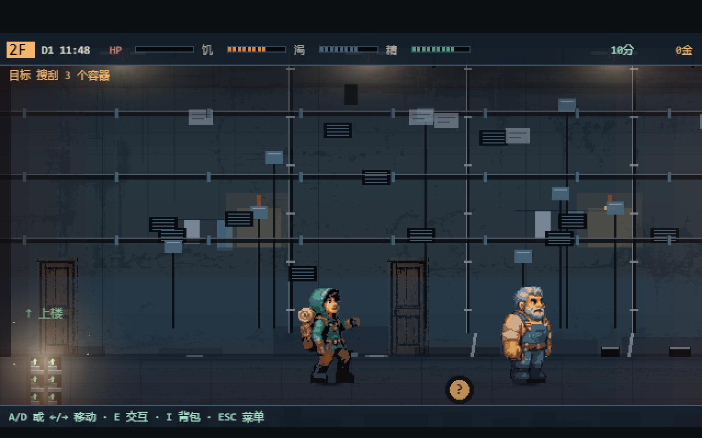
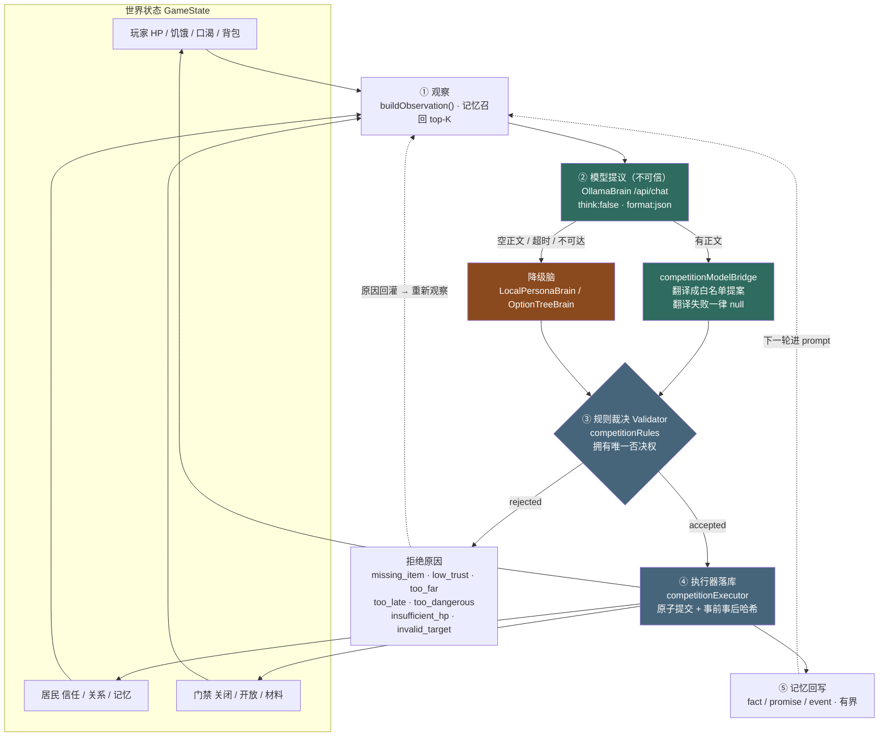

# 第100000层：末日宿舍

> 一座看不见底的十万层末日塔楼。玩家从最底层的一张床醒来往上爬。
> 楼上住着六个人，他们**由大模型提议、由游戏规则裁决**，决定信不信你、给不给你东西、开不开门。

**播放器里 3 秒能看懂的一句话**：这不是"像素生存游戏加个对话框"——NPC 的对白不改变数值，
但它的**决策会真的改变库存、信任和门禁状态**，而模型永远无权绕过规则层。

Phaser 4.2.1 · TypeScript strict · Vite · 82 个单测文件 + 2 个服务端测试文件 · 当前可玩 **第 1–5 层**


---

## 试玩

| | |
|---|---|
| 在线试玩 | `https://a1578804454-floor-100000.ms.show` — **当前为 private（需登录魔搭账号）**，公开访问待开放 |
| 离线运行 | 见下方[本地运行](#本地运行)。不需要任何模型配置即可完整游玩 |
| 演示脚本 | [`docs/competition/DEMO_SCRIPT.md`](docs/competition/DEMO_SCRIPT.md) — 操作提纲，**尚未录制** |

> 为什么如实标注 private：私有创空间需要魔搭登录态才能进。参赛材料的"公开可访问"
> 要求还没满足，写在这里而不是藏在脚注里。

---

## 游戏截图

| 第 2 层：四位邻居同屏 | 第 5 层：食堂 |
|---|---|
|  |  |

<details>
<summary>更多截图：选人、宿舍、搜刮、背包、漏水、死亡结算</summary>

| 出发前选人 | 宿舍（白天） |
|---|---|
|  |  |

| 搜刮容器 | 背包 |
|---|---|
|  |  |

| 天花板漏水 | 死亡结算 |
|---|---|
|  |  |

</details>

> 截图为 1280×720 实机画面。中文像素字体（Ark Pixel 10px）在部分 HUD 位置的
> 抗锯齿会产生轻微重影，这是已知的显示瑕疵，不影响可读性。

---

## AI NPC：三层闭环

这是整个作品的技术主张。**模型只提议，规则裁决，执行器落库。**



完整版（含代理层与三种部署形态）：[`docs/AI_ARCHITECTURE.md`](docs/AI_ARCHITECTURE.md)

### 这三条约束是架构不变量，不是愿望

**① 模型不能凭空创造物资。**

`competitionRules` 检查的是 `npcInventoryFromDef()` 从**报价表**推导出的持有物
（`src/ai/config.ts:131`）。模型说「我有木材」但报价表里没有 → `missing_item`，提案作废。
维修材料清单来自 `ALIN_REPAIR_MATERIALS` 常量（`src/data/floorGates.ts:10`：
木材×2 + 胶带×1），**不由模型生成**。

**② 规则层独立于模型。**

七条拒绝原因（`src/ai/competition-contract.ts:186-194`）全部由纯 TypeScript 判定，
不看模型说了什么，只看世界状态与提案内容。即使模型 100% 恶意，
它也开不了门——门槛是 `trust >= 70` + 材料齐备 + 同层 + 距离内。

**③ 降级不是补丁，是主路径之一。**

模型超时 / 空正文 / 不可达 → 确定性规则脑。玩家看到的是「降级句先显示，AI 句后到」；
对话关了结果就丢弃。**推理挂了游戏完全可玩。**

### ⚠️ 当前的真实缺口（不美化）

| 缺口 | 具体现状 | 影响 |
|---|---|---|
| 只覆盖阿林一条线 | 第二、第三个 NPC 未接入同一闭环 | 泛化性未证明 |
| 记忆影响决策无端到端证据 | **名场面 A「记忆改变行动」的线上验证尚未完成。** 记忆验收段已实现于 `tools/verify-online-api.mjs`（按段落标题「2.6 记忆影响决策」定位，不按行号；含锚点回响、意图分布、`weight` 分级三组对照 + 采样噪声基线），但**线上实例仍为 private，平台层就挡住了**（实测 `GET /` 与 `/healthz` 均 401、门户站 403，连静态首页都要身份），该段**从未在线上执行** | 能证明"prompt 里有"，不能证明"决策因此改变"。现有记忆证据仅来自离线桩，用于验证判据有效性，**不构成线上行为证据** |
| 模型质量未评估 | 只证明"能拿到合法提案且状态真会变" | 见 [`docs/BENCHMARK_REPORT.md`](docs/BENCHMARK_REPORT.md) 的 `【待实测】` |

**已接通的两条（2026-11-25）**，留在这里是为了让"改了什么"可查：

- 维修入口不再走确定性函数。`runAlinRepairScenario(game, { proposeWithModel })`
  把「修不修」交给模型，validator 仍独立裁决「能不能修」；`decisionSource`
  只在模型产出提案且提交成功时才标 `model`。
- 线上实测（`tools/verify-online-api.mjs`）里，缺料时模型回的是
  `request_help` 并准确说出缺 `tape×1`，而不是声称能修。这是"失败后改变计划"
  的第一份线上证据，不是本地夹具。（该项属维修任务契约判据，与记忆无关。）

**换句话说：三层闭环的代码、契约、裁决、执行器、可审计导出全部存在且被测试覆盖，
维修这条路上"模型决策 → 正式游戏入口"已经打通；赠礼与交易仍在离线场景里。**

---

## 六位居民

不是两个商店老板，是一栋还有人住的楼。分散在玩家真正会走的三层
（`src/data/npcs.ts`）。

| 居民 | 楼层 | 身份 | 原型 | bulk | 他在意什么 |
|---|---:|---|---|---:|---|
| 老陈 | 2 | 门房，坐了十几年 | neutral | 0.60 | 守住楼门，把还能住人的楼层记下来 |
| 阿林 | 2 | 维修工 | ally | 1.30 | 守住这层楼的线路，换维修材料 |
| 小周 | 2 | 门边收货的 | neutral | 0.82 | 换到口粮和净水，安稳过天 |
| 大刘 | 2 | 搬货的 | neutral | 1.05 | 把剩下的货搬完，换够吃的 |
| 小满 | 3 | 半大孩子 | neutral | 0.70 | 在三层捡够东西，等家里人回来 |
| 阿珍 | 5 | 食堂厨娘 | ally | 1.12 | 让食堂的灶别熄，来的人都有口热的 |

第 4 层（维修层）**故意没有居民**：那层是漆黑区域，加人前要先处理光照，
否则只是在黑暗里多几个看不见的名字。

**六人里有四位没有手绘图。** 老陈、阿珍、大刘、小满只有调色板 + 体型系数 `bulk`，
20 帧动画在运行时烘焙出来。阿林和小周是早期就有的手绘四角色之二
（`CHARACTER_FILES` 里只有 `player` / `npc_alin` / `npc_xiaozhou` / `wanderer` 四个 PNG）。

同层任意两人的剪影 IoU 必须 < 0.96（`src/tests/npcRoster.test.ts:110`），
否则看起来就是同一个人换了件衣服。第 2 层四人的实测最大重叠是 **0.925**。

想让楼里再多一个人？看 [`docs/npc-sdk-example/ADD_A_RESIDENT.md`](docs/npc-sdk-example/ADD_A_RESIDENT.md)——
改 4 个文件、跑 1 条测试，不需要任何美术资源。

---

## 已完成 / 进行中

评委最反感吹牛。所以分成两栏，只写有证据的。

### ✅ 已完成（有测试或运行记录）

| 项 | 证据 |
|---|---|
| 第 1–5 层完整生存循环：探索、搜刮、交易、制作、睡觉、存档 | `npm run test`；`e2e/survivalJourney.spec.ts` |
| 规则与渲染彻底分离：`systems/` 不 import Phaser | `src/systems/` 32 个纯逻辑模块 |
| 全项目禁用 `Math.random()`，一律 `deriveSeed()` | `src/core/rng.ts`；`src/tests/rng.test.ts` |
| 六位居民，各有独立人格档与体型 | `src/tests/npcRoster.test.ts` 18 项断言 |
| 三层闭环：契约 / 裁决 / 执行 / 记忆 / 可审计导出 | `src/ai/competition-*.ts` |
| 赠礼改变真实库存、信任与记忆 | `src/scenarios/alinGiftDemo.test.ts`；`e2e/competitionAiNpc.spec.ts` |
| 维修门闭环：信任 70 + 木材×2 + 胶带×1 → 材料消耗 + 门禁开启 | `src/scenarios/alinRepairDemo.test.ts`；`src/data/floorGates.test.ts` |
| 软锁防护：第 2 层保底材料箱；制作入口预留维修材料 | `src/tests/craftingSystem.test.ts`；`src/tests/ShelterSystem.test.ts`；`e2e/shelter.spec.ts` |
| 离线回放确定性：3 seed × 3 场景 = 9/9 逐位一致 | `artifacts/benchmark/competition-replay-default-seeds.json` |
| 魔搭 Docker 创空间已部署并 Running | `Dockerfile`；`artifacts/online-verify/api-verify.json` |
| 线上 API 验收 **40 条判据，39 条通过、1 条 FAIL**（**2026-11-26 16:58 那次，带 token、实例公开**；含真实模型推理 3/3、均值 6167ms，**记忆段 8 条全绿**）。唯一那条 FAIL 已查实为**判据假阳性**：路径穿越那条——线上拿到网关 400 错误页，逐字查过没有源码、没有密钥 | `artifacts/online-verify/api-verify.json`（数组 40 条，md5 `9437d7d3…`；`memory-evidence.json`、`memory-weight-evidence.json`、`real-model-runs.json` 同目录）。⚠️ **上一版是 2026-11-26 11:14 的 40 条**（md5 `7bbdc073…`，38 通过 / 2 FAIL，记忆段 7 绿 1 红），**再上一版是 11-25 的 32 条基础段**（md5 `cb827d5a…`，不含记忆段）——三份不能并列引用。覆盖静态产物完整性、同源代理、密钥不泄漏、维修任务契约、**记忆影响决策**、真实模型决策、注入防护、限流与熔断。⚠️ **畸形 URL（`GET /%`）打死服务那条已修**（`0914cc1`，本次部署已含）。详见 `docs/SPARK_DEPLOY.md`、`artifacts/online-verify/README.md`。 |
| 同源代理：Key 在服务端、单会话限流、每日预算、熔断 | `server/npc-proxy.mjs`；`server/npc-proxy.test.mts` |
| DGX Spark 真机推理 6/6 合法提案、中位 3830ms | `artifacts/spark-runs/npc-qwen_latest-2026-11-25T09-52-05-090Z.json` |
| 竖屏适配与触控移动 | `docs/B3-UI-07_MOBILE_PORTRAIT.md`；`e2e/portraitTouch.spec.ts` |
| 桌面版打包 | `npm run dist:win` |

### 🔵 进行中 / 未完成

| 项 | 现状 |
|---|---|
| **模型决策接入正式游戏入口** | 维修路径**已接通**（2026-11-25）；赠礼/交易仍在离线场景 |
| **CI 修复** | 已修：`Build` 前移到单测之前（代理测试真 spawn 服务、静态根是 `dist/`），本地复现「无 dist → 明确报错而非 404」 |
| 单测现状 | 2026-11-26 05:39 实测 **1201 通过 / 6 跳过 / 0 失败**（1207 项，86 文件）；复现命令 `npx vitest run` |
| 公开试玩 | 创空间 Running 但 **private** |
| 演示视频 | 未录制 |
| 多 seed benchmark | 全部 `【待实测】`，见 `docs/BENCHMARK_REPORT.md` |
| 真人试玩 | 未做。自动化测试不能代替"好不好玩" |
| 第二 NPC 接入闭环 | 只覆盖阿林 |
| 跨天记忆影响决策 | **无端到端证据。** 记忆验收段已实现于 `tools/verify-online-api.mjs`（按段落标题「2.6 记忆影响决策」定位，不按行号；含锚点回响、意图分布、weight 分级三组对照 + 采样噪声基线），但**线上实例仍为 private，平台层就挡住了**（`GET /` 与 `/healthz` 均 401、门户站 403），**该段从未在线上执行**。现有记忆证据仅来自离线桩，用于验证判据有效性，不构成线上行为证据 |
| 一天里约 8 小时无事可做 | `docs/M1_PLAYTEST.md` 实测，内容量问题 |
| 五层内容是一次性的 | 回取一趟之后再无上楼理由 |
| 代码许可证 | **MIT**（权利人 2026-11-26 定稿，见 `LICENSE`） |
| 美术素材再分发条款 | **纳入同一份 MIT**：权利人 2026-11-26 确认美术不排除在 MIT 之外 |

---

## 本地运行

需要 Node.js 20+（CI 用 20 与 22，本地开发在 22 上验证）。

```bash
npm install
npm run dev
```

然后打开终端提示的地址（默认 http://localhost:5173）。

**不需要任何模型配置即可完整游玩。** 默认 NPC 是确定性规则脑，
对话标签显示「本地行为 AI · 规则驱动」——这是诚实标注，不是模型生成。

### 可用脚本（`package.json` 实际内容）

| 命令 | 作用 |
|---|---|
| `npm run dev` | 启动开发服务器 |
| `npm run typecheck` | `tsc --noEmit`，TypeScript strict |
| `npm run test` | Vitest 单测（`vitest run`） |
| `npm run build` | `tsc && vite build`，产出 `dist/` |
| `npm run preview` | 本地预览生产构建 |
| `npm run test:e2e` | Playwright 浏览器测试 |
| `npm run test:live-proxy` | 先 build，再跑针对真实构建产物的 live 测试 |
| `npm run competition:benchmark` | 离线回放基准（确定性，不需要模型） |
| `npm run electron` | 以桌面窗口运行（需先 build） |
| `npm run dist:win` | 打包 Windows 可执行版 |
| `npm run dist:installer` | electron-builder 生成 NSIS 安装程序 |

### 启用真实模型（可选）

```bash
cp .env.example .env.local
# 编辑 .env.local：VITE_OLLAMA_URL / VITE_NPC_MODEL / VITE_NPC_THINK=off
```

详见 [`docs/SPARK_DEPLOY.md`](docs/SPARK_DEPLOY.md)（含直连与同源代理两种形态、
排障顺序、以及一个只有真机能抓到的坑）。

### 复现测试

- `?seed=42` 固定种子开跑（QA 固定种子：1 / 42 / 2026）
- `?devfloor=3` 直达指定楼层（仅开发模式）
- `?ainpc=0` 关闭 NPC AI

---

## 操作

| 键 | 作用 |
|---|---|
| **A / D** 或 **← / →** | 左右移动 |
| **E** | 交互（开容器、对话、上下楼、床边睡觉） |
| **I** | 背包（← → 选择，Enter 使用） |
| **C** | 制作台（需在宿舍工作台旁） |
| **Q** | 切换武器外观（仅视觉） |
| **ESC** | 暂停菜单 |

**生存节奏**：口渴每小时掉 3 点、饥饿 2 点（`config/game-balance.json`）。
搜刮一个容器花 20 游戏分钟、制作 30、交易 15。背包 12 格。
所以"多搜一个箱子"和"天黑前回得去"是冲突的——这就是游戏。

---

## 技术架构

四层，越往下越不认识 Phaser：

| 层 | 职责 | 体量 |
| --- | --- | ---: |
| `scenes/` | 场景、输入、面板、动画调度 | ~6.9k 行 |
| `ai/` | 契约、裁决、执行、模型桥、记忆、可审计导出 | ~2.6k 行 |
| `systems/` | 游戏规则，纯函数，只吃 `GameState` | ~4.9k 行 |
| `core/` + `data/` + `config/` | 状态、常量、seeded RNG、物品/配方/楼层 | — |
| `tests/` | 单元测试，**比场景代码还多** | ~12k 行 |

**三条刻意的技术决定**：

1. **规则与渲染彻底分开**：`systems/` 不 import Phaser，84 个单测文件无需浏览器。
2. **随机必须可复现**：全项目禁用 `Math.random()`，一律 `deriveSeed(seed, day, 用途)`。
   同种子必然同结果——这是离线回放基准能工作的前提。
3. **不用物理引擎**：连 Arcade Physics 都没开。移动是手写的速度斜坡，2D 横版不需要刚体。

### 质量门槛

| 关卡 | 规模 | 命令 |
|---|---|---|
| 类型检查 | TypeScript strict，`noUnusedLocals` / `noImplicitOverride` | `npm run typecheck` |
| 单元测试 | `src/` 84 个 + `server/` 2 个 = 86 个测试文件（`vitest.config.ts` 的 include）；2026-11-26 05:39 实测 **1201 通过 / 6 跳过 / 0 失败**（1207 项） | `npx vitest run` |
| 浏览器测试 | 34 个 E2E spec + 2 个 live spec | `npm run test:e2e` |
| CI | push / PR 跑 typecheck、单测、build（确定性门槛）；E2E 为观测项不阻断 | `.github/workflows/ci.yml` |

> **CI 状态如实**：`verify` job（typecheck + 单测 + build）是确定性门槛。
> `e2e` job 设了 `continue-on-error`，因为 Phaser 实时循环下的时序抖动会让
> 个别 spec 在同一 commit 上忽绿忽红（69-72/72 浮动）。
> 当前另有 2 项代理静态资源测试在 CI 上失败，正在修。

浏览器测试能读到真实游戏状态，靠 `src/main.ts` 里一个只在开发模式挂载的
`window.__PHASER_GAME__`——生产构建里没有。

---

## 开源与复用

| 资源 | 内容 |
|---|---|
| **[加一位新居民](docs/npc-sdk-example/ADD_A_RESIDENT.md)** | 改 4 个文件的最小完整示例。含 `bulk` 选择方法、剪影 IoU 实测对照表、7 个常见错误 |
| **[AI 架构](docs/AI_ARCHITECTURE.md)** | 三张 Mermaid 图：三层闭环、含代理层的数据流、三种部署形态 |
| **[Spark 部署](docs/SPARK_DEPLOY.md)** | 模型、环境变量、启动命令、验证命令、排障顺序 |
| **[Benchmark 报告](docs/BENCHMARK_REPORT.md)** | 指标定义与实测值（大量 `【待实测】` 占位，已填部分均标注来源文件） |
| **[第三方声明](THIRD_PARTY_NOTICES.md)** | 逐项许可证核查，含"已核实 / 声称 / 查不到"三档标注 |
| **[LICENSE](LICENSE)** | **MIT，权利人 2026-11-26 定稿**（含署名、美术范围与第三方逐项保留的口径） |

**许可证现状**：仓库此前无 `LICENSE`、`package.json` 无 `license` 字段。
权利人已于 **2026-11-26** 正式采用 MIT：`package.json` 补上 `"license": "MIT"`，
`LICENSE` 定稿并写明三件事——署名 **Zhuyuyangyy**；**美术素材（`public/assets/artpack/`、
`env/`、`title/`、`weapons/`）不排除在 MIT 之外**；第三方组件**各自保留原许可**并逐项列在
`THIRD_PARTY_NOTICES.md`（Phaser MIT / 方舟像素字体 OFL 1.1 / Kenney CC0 / pixelfx MIT）。

---

## 素材与授权

| 类别 | 来源 | 许可证 | 核查状态 |
|---|---|---|---|
| 字体 | Ark Pixel Font（TakWolf） | SIL OFL 1.1，全文在 `public/assets/fonts/OFL.txt` | ✅ 已核实 |
| 选择箭头 | Kenney Pixel UI Pack | CC0 1.0 | ⚠️ 上游 URL 未离线复核 |
| 特效图集 | pixelfx（Patch Pixel / Hugo Duprez） | MIT | ⚠️ 哪些图来自 pixelfx 未逐文件记录 |
| 角色/家具/图标/环境/标题 | 项目负责人提供 | **权利人未声明** | ❌ 待确认 |
| 音效 | 无文件，全部 Web Audio 运行时合成（`src/render/audio.ts`） | — | ✅ 已核实（构建产物无音频文件） |
| 角色骨架 | `art-src/rigs/`，项目代码生成 | — | 版权人未记录 |

**逐项依据与"查不到"清单**：[`THIRD_PARTY_NOTICES.md`](THIRD_PARTY_NOTICES.md)

---

## 目录结构

```
src/
  main.ts            入口（含开发模式下的 E2E 状态钩子）
  scenes/            Boot / Menu / MetaSelect / Game / End
  ai/                契约、裁决、执行、模型桥、记忆、可审计导出、brains/
  core/              GameState、类型、常量、seeded RNG、塔楼模型、存档
  systems/           32 个纯逻辑模块
  render/            程序化像素美术、走图烘焙、光照、Web Audio 合成、UI
  data/              物品、配方、楼层模板、六位居民、人格档
  scenarios/         赠礼 / 维修场景（离线确定性）
  tests/             单元测试
server/
  npc-proxy.mjs      同源代理：静态托管 + 决策代理 + 健康检查
e2e/                 Playwright 测试（开发服务器）
e2e-live/            Playwright 测试（真实构建产物）
tools/               美术流水线、剪影审计、真机运行记录、线上验收
art-src/rigs/        角色骨架（SVG）+ 动画关键帧（JSON）
docs/                设计、路线图、竞赛材料、架构、benchmark
```

---

## 文档索引

**给评委 / 外部开发者：**

| 文档 | 作用 |
|---|---|
| [`docs/AI_ARCHITECTURE.md`](docs/AI_ARCHITECTURE.md) | 三层闭环 + 代理层 + 部署形态 |
| [`docs/BENCHMARK_REPORT.md`](docs/BENCHMARK_REPORT.md) | 指标定义与实测值 |
| [`docs/SPARK_DEPLOY.md`](docs/SPARK_DEPLOY.md) | 模型部署与验证 |
| [`docs/npc-sdk-example/ADD_A_RESIDENT.md`](docs/npc-sdk-example/ADD_A_RESIDENT.md) | 扩展示例 |
| [`docs/COMPETITION_CREATOR_NOTE_DRAFT.md`](docs/COMPETITION_CREATOR_NOTE_DRAFT.md) | 创作手记（含 `【待补】` 清单） |
| [`docs/COMPETITION_SUBMISSION_CHECKLIST.md`](docs/COMPETITION_SUBMISSION_CHECKLIST.md) | 提交清单与证据索引 |
| [`docs/competition/IMPLEMENTATION_STATUS.md`](docs/competition/IMPLEMENTATION_STATUS.md) | AI 集成逐项状态，含失败与未测项 |
| [`docs/03_TASKS.md`](docs/03_TASKS.md) | 任务编号与完成状态 |

**开发约束：**

| 文档 | 作用 |
|---|---|
| [`CLAUDE.md`](CLAUDE.md) | 开发 Agent 的长期约束（流程、质量门槛、范围边界） |
| [`docs/GAME_DESIGN_LOCK.md`](docs/GAME_DESIGN_LOCK.md) | 核心玩法设计冻结，与其它文档冲突时以它为准 |
| [`docs/ROADMAP.md`](docs/ROADMAP.md) | 里程碑与验收标准 |
| [`docs/B3-20_RESIDENT_ROSTER.md`](docs/B3-20_RESIDENT_ROSTER.md) | 从 2 人到 6 人的完整记录，含四个静默缺陷 |

---

## 部署

`npm run build` 生成纯静态站点（`dist/`），可部署到任意静态托管。

公开部署时**必须**用同源代理形态（`server/npc-proxy.mjs`），否则模型 API Key
会打进前端产物、公开给每个访客。这不是建议，是安全边界。

容器构建与魔搭创空间配置见 [`docs/SPARK_DEPLOY.md`](docs/SPARK_DEPLOY.md) §3。

---

## 桌面版（Electron）

```bash
npm run build       # 先构建 dist/
npm run dist:win    # 输出 release/Floor100000-win32-x64/Floor100000.exe
```

以桌面窗口直接运行（需先 build）：`npm run electron`。