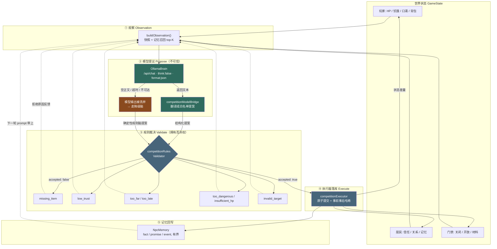
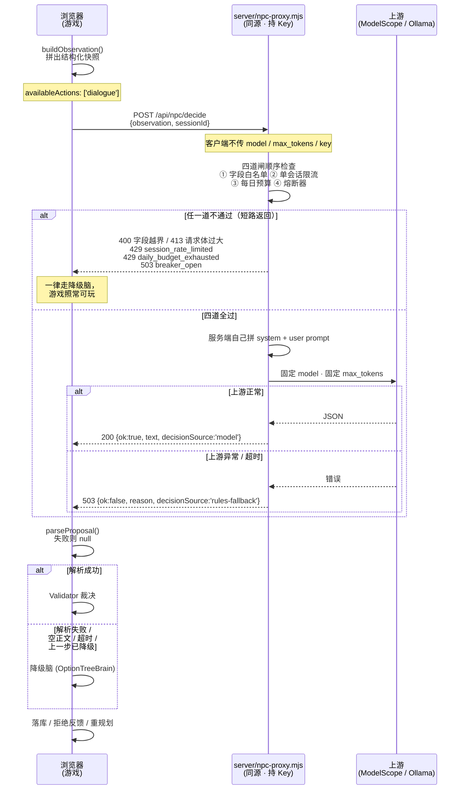
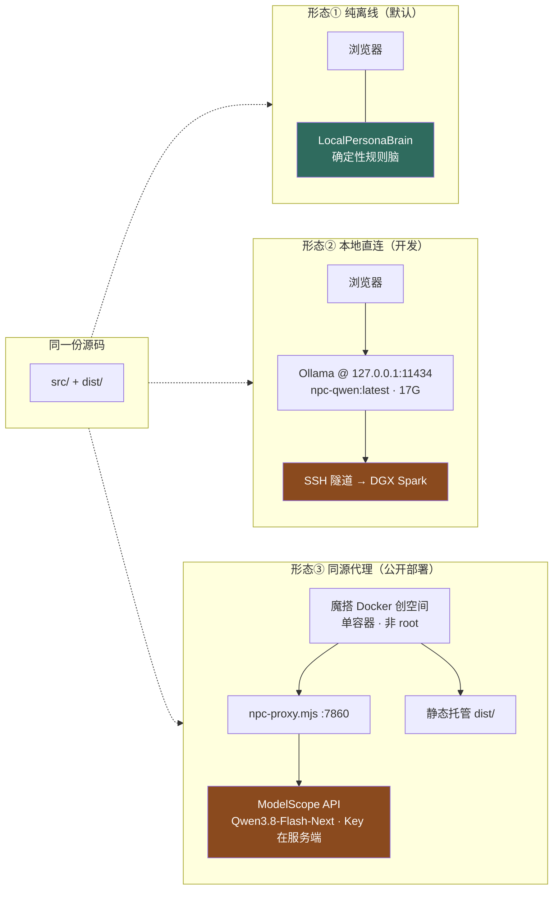

# 架构：三层闭环、代理层、部署形态

> 三张图，对应三个不同的读者问题：
> ① 模型为什么不能乱来？ ② 公开部署时 Key 在哪？ ③ 一套代码怎么跑三种环境？
>
> 所有节点都能在代码里找到对应文件，出处标在图下。

---

## 图 1 · AI 居民的决策闭环

这是整个作品的技术主张：**模型只提议，规则裁决，执行器落库。**

**这张图要说明的三件事**（评委最容易误解的地方）：

1. **模型不能凭空创造物资。** `competitionRules` 检查的是
   `npcInventoryFromDef()` 从报价表推导出的持有物（`src/ai/config.ts:131`）。
   模型说「我有木材」但报价表里没有 → `missing_item`，提案作废。
   维修材料清单来自 `ALIN_REPAIR_MATERIALS` 常量，**不由模型生成**。

2. **规则层独立于模型。** 五条拒绝原因（`src/ai/competition-contract.ts:186-194`）
   全部由纯 TypeScript 判定，不看模型说了什么，只看世界状态和提案内容。
   即使模型 100% 恶意，它也开不了门——门槛是 `trust >= 70` + 材料齐备 + 同层 + 距离内。

3. **降级不是补丁，是主路径之一。** 模型超时/空正文/不可达 → 确定性规则脑。
   玩家看到的是「降级句先显示，AI 句后到」；对话关了结果就丢弃。
   推理挂了游戏完全可玩。

**重规划循环**：拒绝原因回到 ① 重新观察，最多 3 次（`MAX_COMPETITION_RUNTIME_ATTEMPTS = 3`，
`src/ai/competitionRuntime.ts:94`）。

---

## 图 2 · 一次模型决策的实际数据流（含代理层）

四个拒绝码的默认阈值：字段白名单无阈值；单会话 60s/12 次；每日 1800 次；
熔断连续 5 次失败 → 冷却 60s。全部可用环境变量覆盖（见 `docs/SPARK_DEPLOY.md` §3.2）。

出处：`server/npc-proxy.mjs:435-508`（路由与三层防护）、
`src/ai/brains/ollamaBrain.ts:118-175`（health 与 decide）、
`src/ai/config.ts:82-86`（生产构建默认走代理）。

> **一个只有真机能抓到的坑**：代理模式下 `health()` 打的是 `/healthz`，
> 不是 Ollama 原生的 `/api/tags`。写错的话 `/api/tags` 在同源代理上返回 404，
> 「模型可用」被永久误判成「不可用」——UI 永远显示降级，一次请求都发不出去。
> 这个 bug 单测抓不到，因为单测里没有代理。见 `ollamaBrain.ts:118-136` 的注释。

---

## 图 3 · 一套代码，三种运行形态

**裁决层在三种形态里完全相同**（`src/ai/rulesExecutor.ts` + `competitionRules.ts`）。
变的只有传输层：直连打 Ollama，代理打自家后端，离线根本不发请求。

判定逻辑在 `aiNpcConfig()`（`src/ai/config.ts:69-107`）：

| 条件 | mode |
|---|---|
| 未设 `VITE_NPC_MODEL` 且非生产构建 | `offline` |
| 设了 `VITE_NPC_MODEL`，非生产构建 | `ollama` |
| `vite build` 生产构建 | `proxy` |
| `VITE_NPC_PROXY=off` | 强制不走代理 |

---

## 附：为什么不用状态机而用「回合制闭环」

`runCompetitionStep()`（`src/ai/competitionRuntime.ts:107`）的结构是
**观察 → 选目标 → 规划 → 提议 → 裁决 → 执行 → 反馈**，最多 3 次。

不用长驻状态机的理由很实际：每次重规划都必须**重新观察**，因为上一次尝试
可能已经改变了世界（执行成功但校验失败、或部分提交）。缓存观察会让重规划
基于过期状态做决定。这个方法里每一轮都调 `ports.observe()`，不是优化疏忽。

---

## 已知限制：`isDecisionFresh` 未接线

`src/systems/NpcRuntime.ts:123` 定义了 `isDecisionFresh`，它比生产路径上实际在用的
`isDialogueFresh` 更严：除 session/revision 外还比较 `day` 与 `gameMinute`，也就是
**逻辑时间推进也会让在途决策过期**。它有 5 条单元测试，但**生产代码零调用点**
（`grep -rn "isDecisionFresh" src --include=*.ts` 只命中定义与该测试文件）。

同时，对话框打开期间游戏时钟是**冻结**的：`GameScene` 的 `update` 在面板打开时
提前 return（`:5145`，条件含 `dialogueOpen`），`advanceTime` 在那之后（`:5194`）才执行。对话内唯一
会推进时钟的动作发生在 `activateDialogueOption`，而它第一行就 `d.revision += 1`
（`:3859`）——所以时间通道能抓到的过期，revision 通道已经先抓到了。

> 行号会因 `GameScene.ts` 持续重构而漂移，引用前用
> `grep -n "advanceTime(state, delta)" src/scenes/GameScene.ts` 复核。

两者叠加的结论：**这个判据既没接线，在当前产品形态下也不必要。**

登记为已知限制，本轮不补实现。理由不只是「收益为零」，还有顺序问题：

> **先接线，再加数据源。反序会造出第二个「存了没人读」的字段。**

`isDecisionFresh` 现在需要调用方传入 `DecisionFreshness`（含 `day`/`gameMinute`），
而 `NpcDecision` 本身不带观察时刻。如果先给 `NpcDecision` 加必填的 `observedAt`，
得到的状态是「字段被构造、被 6 个 return 强制填上、类型系统保证它存在」，然后
在唯一的消费点 `enhanceOpeningLine` 那里没人读它——形状与 `weight` 那个缺陷
（`7d2e02c`：字段存了、校验了，拼提示词时被丢掉）完全相同，只是断在链路的不同
位置。中间态比现状更危险：现在大家知道保鲜没接上，加了一半会让人以为接上了。

将来真要做，三件事必须**同一个提交**完成，不能拆：

1. `NpcDecision` 加必填 `observedAt: { day, gameMinute }`（必填，不用可选——
   可选字段会被新调用方忘掉，保鲜逻辑静默退化）；
2. 合成函数 `captureDecisionFreshness(state, session)` 统一构造比较两侧；
3. `GameScene.enhanceOpeningLine` 改用 `isDecisionFresh`，并在 `NpcRuntime.ts`
   的 **6 个** `NpcDecision` 构造点（`:166 :169 :172 :187 :188 :190`）填上字段
   ——其中 `:169`/`:187` 是 `return { validated, source }` 简写，加字段时必须展开。

真正会需要它的时机是：`allowedActions` 放开、有副作用的行动（`trade`/`repair`）
接通到这条路径上。那时 plan 在 `revision` 递增之后才捕获，**只有时间通道能抓到
过期**，届时换用才是有效收益。对应的验收是「观察时刻变了 → 决策被丢弃」，需要
一条 E2E 专测。

---

## 代码位置索引

| 层 | 文件 | 关键函数 |
|---|---|---|
| 观察 | `src/systems/NpcRuntime.ts` | `buildObservation()` |
| 观察（竞赛契约） | `src/ai/competition-contract.ts` | `CompetitionObservationSnapshot` |
| 提议（传输） | `src/ai/brains/ollamaBrain.ts` | `decide()`、`health()` |
| 提议（翻译） | `src/ai/competitionModelBridge.ts` | `buildCompetitionPrompts()`、`proposeWithBrain()` |
| 提议（降级） | `src/ai/brains/optionTreeBrain.ts`、`localPersonaBrain.ts` | `decide()` |
| 裁决 | `src/ai/competitionRules.ts` | `validateProposal()` |
| 裁决（旧路径） | `src/ai/rulesExecutor.ts` | `validateProposal()` |
| 执行 | `src/ai/competitionExecutor.ts` | 原子提交 |
| 记忆 | `src/systems/NpcMemory.ts` | `recall()`、`recordMemory()` |
| 闭环编排 | `src/ai/competitionRuntime.ts` | `runCompetitionStep()` |
| 代理 | `server/npc-proxy.mjs` | 请求处理与三层防护 |
| 部署 | `Dockerfile`、`ms_deploy.json` | — |