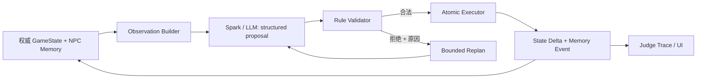

# 《第100000层·末日宿舍》冲奖总控计划

**重建版 · 2026-11-26 · AI 游戏作品 / 最佳 AI NPC 奖专项**

> 使用方法：将本文件放在仓库 `docs/competition/MASTER_SPRINT_PLAN_20261126.md`，发给总控 agent 和各工作 agent。它是工作指令，不是已经完成的功能清单。原工作环境中的 Markdown 当前不可访问；本版根据本轮对话中可见的原计划、用户给出的 Git 信息及赛事截图重建，并扩充任务契约、分工和验收。所有代码路径、测试基线、线上状态必须先在实际仓库重新核验。

- 仓库：https://github.com/Zhuyuyangyy/floor-100000
- 赛事：https://modelscope.cn/active/AIstudio
- 用户提供的发布基线：`deploy-ms-20261125` / `526cdb9`，完整 SHA 据上一轮记录为 `526cdb96c99bf94d671dc616b2681f50545268d6`。
- 记忆决策因子：上一轮记录 `7a9b486` 已在 HEAD 祖先链上，与 `f62fdd8` 等价；本次重建未独立复核。
- 决策优先级：最佳 AI NPC > 综合奖 > 最佳 AI 原生玩法/其他特别奖（是否可兼得以正式规则为准）。
- 时间约束：11 月 30 日 Spark 资源可能到期，提前完成真实模型证据；提交时间以官方最新公告核验，内部按 12 月 1 日 10:00 前完成全部提交准备，不把冲突的报名时间或提交时间当作已确认事实。

## 0. 总指挥令

不要追求 100000 个可探索楼层。最后几天把一栋末日宿舍做成可完整试玩、有人格、有经济、有危机、有选择后果、AI 真实参与的高密度垂直切片。第一章 8–12 分钟，第二轮 3–6 分钟能体验不同结果。所有 agent 必须以评委可观察证据为交付物，不能以代码行数、素材数、工具数或模型调用次数充当成果。

**基本原则：先玩法与 AI 闭环，再表现；美术可以并行制作，但由唯一场景集成 owner 接线；稳定性和证据从第一天并行。**

### 不得突破的红线

- 公开试玩必须从普通入口进入，不依赖控制台、测试夹具、管理员预设或手工改存档。
- 不能让语言模型绕过游戏规则直接改库存、门锁、生命、进度或关系；所有变更通过白名单与原子执行器。
- 不得把 fallback、脚本或预录动画冒充 Spark 实时决策；界面和日志必须区分来源。
- 不为冲刺引入大型框架迁移、全新 ECS、全新物理系统、全量 UI 重写或不清楚许可证的资产。
- 不向公开仓库、前端构建、录屏或导出日志暴露密钥、令牌、机器访问凭据。
- 不虚构创作手记、测试成绩、玩家反馈、部署状态或模型表现。

## 1. 评分倒推

以下分数是内部质量目标，不是实际评审结果或获奖概率。

| 评分维度（截图） | 满分 | 目标 | 可见证据 |
|---|---:|---:|---|
| 可玩性 | 30 | 27 | 新手教学、完整危机循环、有效决策、反馈、无软锁、可复玩 |
| AI 运用 | 25 | 24 | 记忆影响动作、真实 Spark、规则裁决、失败重规划、自主行动、实际状态差量 |
| 作品完成度 | 20 | 18 | 匿名公开试玩、稳定部署、存档、异常回退、测试、明确章节结局 |
| 创意与呈现 | 15 | 13 | 末日宿舍叙事、像素视觉统一、音效、楼层环境、差异化结局 |
| 创作手记质量 | 10 | 9 | 真实开发过程、技术图、踩坑和修复、许可证、视频、复现方法 |
| 合计 | 100 | 91 | 内部冲刺目标 |

专项“最佳 AI NPC”：截图要求 NPC 结合角色记忆与游戏状态自主决策，通过实际行动影响游戏进程。我们的内部加严要求：至少三个具备不同目标、库存、关系、记忆的 NPC；至少两名真实模型完成不同类型的游戏行动；至少一次不由对话按钮直接触发的自主动作；至少一次相同请求因历史或状态不同产生可解释的不同结果。

综合奖需要可玩性和完成度，绝不能把游戏变成纯技术演示；Judge Mode 是辅助证明，不是唯一玩法。

## 2. 产品定位与内容设计

**一句话：** 停电后的末日宿舍中，居民会记得你过去做过什么，根据目标、信任和库存自主选择行动；每次选择都会在真实游戏规则约束下改变物资、关系、门禁与生存进程。

### 第一章：停电之前与停电之后

- 初始目标：在能源与物资不足的宿舍中恢复供电，保障居民生存，抵达第五层关键区域。
- 游戏循环：探索 → 搜集 → 观察居民 → 协商或交易 → 合法执行 → 世界改变 → 新危机/新选择 → 结算。
- 关键矛盾：电池、维修件、食物、净水有限；不同居民的利益不同。赠礼提升信任的同时也消耗玩家的真实物品。
- 不强制唯一解：可通过互助、交易或付出额外探索成本推进。任何路线不得形成不可恢复的任务软锁。
- 结局建议：互助修复（关系较好）、勉强恢复（以库存或关系为代价）、危机恶化（可重新开始或继续补救）。具体名称与机制由关卡 owner 根据实际数据结构确定。

### 楼层内容（按现有地图结构微调，不要求重建）

| 楼层 | 任务作用 | 交互重点 | 表现与反馈 |
|---|---|---|---|
| 主基地/一层 | 教学、初始资源、接收危机 | 移动、拾取、E 交互、任务追踪 | 安全区灯光、明显出口、帮助提示 |
| 二层居民区 | 建立第一段关系 | 阿林维修意向；小周交易或协作 | 居民状态、物品/信任变化 |
| 三层探索区 | 获得维修材料和交换筹码 | 搜刮、有限危险、资源路线选择 | 环境提示、稀缺感、拾取反馈 |
| 四层停电区 | 风险与资源收益绑定 | 黑暗、应急光源、绕行或补救 | 不得纯黑无路；危险和收益可读 |
| 五层食堂/关键节点 | 完成另一条居民线和阶段结算 | 阿珍净水/食物交换、回礼、危机结果 | 恢复供电演出、章节结算、下一层预告 |

### 居民设计（示例，使用现有实体 ID，不要未经核验重命名）

| NPC | 目标 | 决策差异 | 可见后果 |
|---|---|---|---|
| 阿林 | 修复设施、保护居民 | 受信任、工具/材料、危险与记忆影响 | 维修、请求帮助、拒绝、开门或推进供电阶段 |
| 小周 | 保持个人生存物资、合理交易 | 受个人库存、稀缺程度、历史交易与关系影响 | 改变双方库存、报价、合作意愿 |
| 阿珍 | 维持食堂和群体供应 | 受净水/食物存量、危机与互助记忆影响 | 接受赠礼、回礼、拒绝、保留库存、影响食堂状态 |

每个居民至少准备一种正面记忆、一种负面记忆和一种中性/交易记忆。记忆必须有结构化来源与实际世界事件，不是只塞对话全文。关系变化要能解释、可追踪、有限幅度。可选扩展为背景居民，但不要让背景人口增加压垮核心流程。

## 3. 评委试玩黄金路线

| 时间 | 普通玩家操作 | 必须观察到的反馈 |
|---|---|---|
| 0:00–0:30 | 打开公开 URL，开始，移动与拾取 | 无登录/无控制台；目标、操作、UI 清楚 |
| 0:30–2:00 | 找阿林，赠礼或协商 | 库存/关系/记忆真实变化；能看见 AI 决策来源 |
| 2:00–4:30 | 停电危机，提出维修 | 材料不足时规则拒绝；明确去哪找什么；禁止凭空成功 |
| 4:30–6:30 | 找小周交易 | 合法报价、库存原子更新、记忆回写 |
| 6:30–8:30 | 探索并到五层找阿珍 | 净水/食物等资源交互，居民判断和库存变化 |
| 8:30–10:00 | 返回阿林或推进危机 | 二次观察引用新记忆与状态；自主行动可见；章节结算 |

另备 3 分钟评委快速路径：在正常 UI 中快速展示一次记忆影响、一次规则拒绝与重规划、一次世界状态变化。若提供演示模式，必须明确标识演示初始条件，不能冒充正常开局；正式试玩也须能完成同一机制。

## 4. AI 技术架构与契约



### Observation

读取 NPC ID、人格与目标、当前位置、当前危机阶段、NPC 与玩家库存、信任/好感/张力、近期结构化记忆、相关世界对象和可选行动。明确哪些数据来自权威状态、哪些是模型解释；限制输入规模，避免记忆无限增长。未提供的物品、坐标和动作不可凭空使用。

### Proposal / Validator / Executor

- 提案采用现有 schema（以下为说明性的字段名，不要求强行改接口）：`npcId`, `action`, `targetId`, `itemId`, `quantity`, `reason`, `observationRevision`。
- 动作白名单候选：`dialogue`, `gift`, `trade`, `repair_gate`, `refuse`, `accept_gift`, `request_help`。按当前实现登记，不允许自由执行模型返回的命令。
- 校验：动作枚举、参数类型、目标存在性、距离、角色权限、数量与库存、信任阈值、危机阶段、时间、冷却、状态版本。示例拒绝码：`low_trust`, `missing_item`, `invalid_target`, `too_far`, `invalid_quantity`, `stale_state`, `too_late`, `too_dangerous`。
- 模型不能判定交易已经成交；执行器在提交前再次校验。失败无半笔库存或关系变化；同一请求不可重复执行。
- 若拒绝，最多允许一次或两次受限重规划，把结构化拒绝原因与重新采集的状态交给模型；仍失败则进入安全 fallback/明确拒绝。
- 事件追踪：`requestId`, `npcId`, `actor`, `trigger`, `decisionSource`, `observationRevision`, `proposal`, `validatorResult`, `executionResult`, `stateDelta`, `memoryEvent`, `latencyMs`。公开日志做最小化与脱敏。

### Spark 与模型服务

- 先核验 DGX Spark 在线状态、模型服务地址、模型名/版本、代理与认证配置、资源期限；禁止假设 Spark 本地服务已公开可达。
- 前端 → 同源或受控 NPC proxy → Spark 推理。密钥只在服务器；用环境变量配置，健康检查可观测但不泄露敏感配置。
- 针对同一 NPC 串行或有锁执行；请求有超时、有限重试、并发限流、幂等 ID、状态版本保护。取消/切换楼层/刷新时不能造成重复交易。
- UI 即时显示“居民正在思考”，可继续不相关移动；避免阻塞渲染线程和锁死界面。
- 区分 `spark/model`、`offline-fallback`、`scripted`（以现有枚举为准）；失败原因单独记录，不把 fallback 冒充实时模型。
- Spark 到期前采集真实互动证据；正式部署须有经过实测的可用推理服务或明确的离线降级。如果评委无法接入 Spark，必须如实说明，不能用录屏掩盖。

### NPC 自主行为（P0）

至少一次正常世界事件触发而非玩家按 E 后直接调用：停电阶段变化、游戏小时边界或资源阈值跨越时，居民检查自身状态、记忆和目标，提出保护物资/请求帮助/维修准备等白名单动作。

调度约束：同一 NPC 同一阶段最多一次；节流；世界状态 revision 校验；重复触发不重复扣库存；场景切换或重载可恢复已处理标记；记录 `actor=world_tick`（实际枚举由 runtime owner 确认）。不要每帧调用模型。

### 记忆有效性反事实测试

构造两条独立正常游戏路线（QA 可用测试夹具验证机制，提交演示用真实操作）：相同当前请求，历史互助/背弃不同；尽量控制其他条件或记录差异。观察候选行动/报价/接受与否/理由的可解释变化。重复采样，不把一次随机输出差异当作因果证据。至少有结构化决策因子对行动或规则结果产生明确影响；不能只是语气变化。

## 5. 并行 Agent 编组和文件所有权

所有 agent 从同一冻结 SHA 创建独立分支/worktree；每个只改授权文件。先由总控核验实际目录，以下路径是建议边界。新增共享接口由 owner 提前发布契约，调用方使用 mock，不能私自重构。

| Agent | 工作域 | P0 交付 | 禁区/依赖 |
|---|---|---|---|
| A0 总控/架构 | 任务板、接口契约、分支顺序 | 基线、优先级、冲突裁决、每日可运行 build | 不代替各 owner 随意改文件 |
| A1 AI Runtime | `src/ai/*`, `src/ai/brains/*` 等实际 AI 模块 | 三 NPC observation/proposal、记忆决策、replan、结构化 trace | 不直接改场景/地图 |
| A2 Spark/服务 | `server/npc-proxy.mjs`、部署、健康检查 | 真模型请求、超时/重试/降级、秘密管理、延迟报告 | 不改前端场景；与 A1 约定协议 |
| A3 Scene Integrator | 唯一拥有 `GameScene.ts`、场景入口、tick 调度 | 三 NPC 正式入口、世界 tick、真实来源标签、键鼠操作 | 接收 A1/A4/A5 的接口，不复制其逻辑 |
| A4 玩法/规则 | 世界状态、任务、库存、交易、危机、存档相关模块 | 五层闭环、资源守恒、无软锁、结局、复玩 | 不改 AI schema 和场景主文件 |
| A5 UX/UI | UI/HUD/菜单/背包/目标/对话/结算组件 | 30 秒上手、状态差量反馈、清晰可读 | 主场景接线交 A3，禁止大规模 UI 重写 |
| A6 关卡/内容 | 地图配置、NPC 配置、可交互对象、任务文本 | 每层有功能、资源链可解、NPC 差异化 | 与 A4 核对配置与规则，避免重复资产 ID |
| A7 美术/VFX | `assets`、sprite、atlas、图标、效果资源/独立渲染模块 | 统一像素美术、关键视觉资源、至少 2–3 个可见特效 | 先交资产和接线说明，A3/A5 执行场景接线 |
| A8 音频/叙事 | 音效、音乐、短叙事、可选对白 | 交易/维修/拾取/危机/结算音效，文字简洁 | 合法授权，静音设置；不改核心逻辑 |
| A9 QA/红队 | 测试、试玩矩阵、缺陷单 | 实机正常路径、对抗输入、存档、并发、fallback、跨端验证 | 禁止为了过测删测试/降低断言 |
| A10 证据/创作手记 | `docs/competition/`、录屏、截图、指标 | 真实过程、技术图、三段关键证据、许可证清单 | 不将未通过功能写成已交付 |
| A11 Release | 合并、CI、部署、回滚、最终 SHA | release candidate、公开 URL、复现命令、提交清单 | 唯一负责主线合并与 lockfile 冲突处理 |

### 合并纪律

- 一张任务卡 = 单一功能闭环 + 对应测试 + 可见证据 + 回滚方式。
- 禁止多个 agent 同时编辑 `GameScene.ts`、`server/npc-proxy.mjs`、`package-lock.json` 或同一核心状态 schema。
- 每个分支提交说明包括：目标评分项、改动文件、测试命令、实际结果、截图/日志、未完成问题、依赖和迁移风险。
- 每次合并先运行定向测试；每天至少一次全量构建与人工试玩。禁止盲目把全部分支一起 merge。
- 统一 PR 阶段：Ready → Review → Integration → Smoke → Accepted；未验收不算完成。P0 失败立即回滚或修复。
- 总控每天记录基线 SHA、当前集成 SHA、部署 SHA、各 agent 阻断、当天实际测试数据。

## 6. 任务卡与验收交付

| ID | 优先级 | Owner | 任务 | 完成判据 |
|---|---|---|---|---|
| BASE-01 | P0 | A0/A11 | 核对仓库与部署 | HEAD/远端/部署 SHA 一致；列出未合并差异，不把等价补丁重复合并 |
| AI-01 | P0 | A1 | 阿林真实模型维修 | 自然入口、材料不足拒绝、补齐后执行，日志有状态差量 |
| AI-02 | P0 | A1/A4 | 小周真实模型交易 | 双方库存与报价一致；无负数、无双扣、记忆写入 |
| AI-03 | P0 | A1/A6 | 阿珍真实模型交换 | 回礼来自实际库存；库存不足明确拒绝 |
| AI-04 | P0 | A1 | 结构化记忆决策 | 对照路线中动作/约束产生可解释差异，测试证明不是只有文案 |
| AI-05 | P0 | A1 | 规则拒绝/重规划 | 非法提案拒绝，不改变状态；有限重试后可见处理结果 |
| AI-06 | P0 | A3 | NPC 自主 tick | 一次未按 E 的世界触发真实行为，状态变化、来源明确 |
| AI-07 | P0 | A2 | Spark 服务与降级 | 真实模型回合可复现；失败不阻塞且来源标签正确 |
| AI-08 | P0 | A3/A5 | Judge Mode | 等待/成功/拒绝/降级准确显示当前 NPC、模型来源和真实 trace |
| GAME-01 | P0 | A4/A6 | 第一章完整闭环 | 8–12 分钟自然走完；危机、搜集、交易、结算都有 |
| GAME-02 | P0 | A4 | 资源守恒/原子事务 | 不可凭空生成物品，不可重复扣库存，不可执行失效报价 |
| GAME-03 | P0 | A4/A6 | 黑暗层与楼层进出 | 无纯黑软锁；危险有提示、资源有收益、楼梯可靠 |
| GAME-04 | P0 | A4 | 保存和恢复 | 刷新/重新进入恢复有效存档，版本不兼容有安全提示 |
| GAME-05 | P1 | A4/A6 | 多路径结局 | 至少两种可复现的代价或结局；玩家知道后果 |
| UX-01 | P0 | A5 | 首屏引导/任务追踪 | 新玩家不靠说明书，30 秒内能完成首次有效交互 |
| UX-02 | P0 | A5 | 交互与库存 UI | 当前目标、物资变化、NPC 思考和拒绝理由清晰可读 |
| UX-03 | P1 | A5 | 结算卡/关系反馈 | 每项反馈对应真实状态；提供重新开始或下一步 |
| ART-01 | P1 | A7 | 关键角色与地图统一 | 阿珍等关键 sprite 接入、比例一致、轮廓清楚、不挡 UI |
| ART-02 | P1 | A7/A3 | 灯光/夜景/维修 VFX | 黄金路线实际触发；不只注册不调用，不影响碰撞和帧率 |
| AUD-01 | P1 | A8 | 音频反馈 | 拾取、交易、维修、危机与结算辨识度高；可静音 |
| QA-01 | P0 | A9 | 浏览器 E2E | 新开无存档会话真实操作；同样验证 fallback 路线 |
| QA-02 | P0 | A9 | 对抗与异常矩阵 | 非法动作、无物资、重复交互、跨楼层、超时、网络断开均验证 |
| QA-03 | P0 | A9 | 真实玩家试玩 | 至少 3 次独立试玩目标；记录用时、卡点、实际反馈 |
| EVD-01 | P0 | A10 | 真实证据 | 20–30 回真实模型回合目标；原始日志、视频时间码、版本信息 |
| EVD-02 | P0 | A10 | 创作手记 | 真实工具使用、取舍、失败、修复、复现、第三方许可证 |
| REL-01 | P0 | A11 | 公开部署/提交 | 匿名冷启动、正式 URL、SHA、构建结果、回滚、材料齐全 |

### 工作 agent 通用指令模板

```text
你是 floor-100000 的 [Agent ID]。阅读本总控计划及仓库实际文档。
1. 记录当前 SHA，检查实际文件及已有测试；不要重复实现已有功能。
2. 只改自己文件域。需要共享改动时先输出契约和补丁请求给唯一 owner。
3. 优先完成 P0 任务卡；P1 只有在 P0 通过后接线，不能引入新阻断。
4. 每项任务先复现问题，给出最小方案，然后实现、测试、人工验证。
5. 对真实 Spark、fallback、脚本来源严格区分。不得造假、删测试或绕过游戏规则。
6. 交付：commit SHA、文件清单、命令与真实输出、可见截图/日志、缺陷/风险、回滚方式。
7. 不要自行合并发布主线；通知总控按依赖顺序集成。
```

## 7. 开源资源接入策略

优先使用仓库已持有并经许可证审核的资源。以下仓库是上一轮建议候选，重建时未重新联网核实当前许可证或版本；引入前必须检查具体 revision 的 LICENSE、素材单独授权、署名要求、文件来源以及与构建兼容性。

| 项目 | 链接 | 建议用途 | 决策 |
|---|---|---|---|
| pixelfx | https://github.com/patch-gg/pixelfx | 已接入像素特效；停电、维修、交互、命中 | 优先复用现有资源，补真实调用，不再堆素材 |
| Mistreevous | https://github.com/nikkorn/mistreevous | 行为树 guard、异步动作、可视化参考 | 只参考，不迁移现有规则引擎 |
| Behavior3JS | https://github.com/behavior3/behavior3js | Blackboard、行为树结构参考 | 不新增核心依赖 |
| Yuka | https://github.com/Mugen87/yuka | 导航、steering、感知参考 | 仅当实机确认移动/卡墙是阻断且小补丁可解时使用 |

搜索新增素材时先查现有 artpack/ui/fx；优先小体积、适配现有像素尺寸、浏览器可运行、授权明确的资产。不要因为 GitHub 上有项目就把代码或美术全量复制。每个第三方条目记录 URL、commit/tag、文件路径、许可证、署名、修改情况、使用场景。若没有明确授权，不接入。

美术交付要求：透明 PNG 或兼容现有 atlas；统一像素比例、anchor、碰撞区、朝向、帧数、命名；补资源 manifest、预览、场景接线说明。所有关键图必须在最终构建中可见。优先检查已注册未调用的 `spirit-flame`, `wisp`, `bat`, `portal`, `bullet-impact` 等效果是否适配游戏，而不是强制每个都加。

## 8. 分波次冲刺日程

日期为内部计划，随正式截止与实际可用算力调整。11 月 30 日前拿齐 Spark 证据。

| 波次 | 时间 | 必须交付 | 合并条件 |
|---|---|---|---|
| W0 基线 | 11/26 深夜–11/27 早 | SHA 对齐、基线测试、玩法缺口表、agent 分支、接口冻结 | 发布线可构建；问题分 P0/P1/P2 |
| W1 AI 闭环 | 11/27 | AI-01～08 核心；Spark 服务；真实入口；自主 tick | AI 单测及自然路径通过，至少两 NPC 真模型行为 |
| W2 可玩性 | 11/27–28 | GAME-01～05、关卡资源、UI 教学与反馈 | 可完成第一章；无软锁；QA 复验 |
| W3 表现 | 11/28–29 | 接入关键角色、灯光、特效、音频；修真实试玩卡点 | 不破坏 W1/W2；特效确实触发；性能稳定 |
| W4 证据部署 | 11/29–30 | Spark 真实日志、公开试玩、创作手记、演示录屏、许可证、发布候选 | 公共链接实测、全量测试、证据与 SHA 可对齐 |
| W5 冻结提交 | 11/30–12/1 内部截止前 | 提交、回滚包、最终核对 | 只修阻断；禁止新增系统或玩法 |

每轮结束只接受可运行版本。若某任务未完成，先保证黄金路线，不把不稳定的扩展拖进 release。每天最后一次构建作为可回滚快照。正式提交时间须在官方入口实地核验。

## 9. 最终验收标准（Release Gate）

### G1 可玩性（全 P0 通过才放行）

- [ ] 从匿名窗口公开 URL 开始，30 秒内完成第一次有效交互；无需特殊参数。
- [ ] 8–12 分钟内自然完成第一章，存在危机、搜集、协商/交易、世界变化和清楚的结算。
- [ ] 至少两条有区别的决策路线或代价；失败可恢复或明确重新开始。
- [ ] 楼梯、碰撞、相机、E/F 交互、UI、背包和目标追踪正常；无卡住、纯黑和不可达关键资源。
- [ ] 保存、刷新、重开和存档迁移/异常处理正常。

### G2 AI NPC 专项（不能只靠对话）

- [ ] 阿林、小周各有至少一次正式入口真实 Spark 模型行动；阿珍的正式库存交互有真实证据。
- [ ] Observation 中包含当前状态、真实库存、关系与有来源的结构化记忆。
- [ ] 记忆对实际动作/报价/合法选项产生可验证影响，而非仅影响语气。
- [ ] 低信任、缺材料、非法 JSON、未知动作/目标/物品、越界数量、过期状态、重复请求均正确拒绝。
- [ ] 合法动作真实改变游戏状态；非法动作不穿透；库存不为负、不会双扣、不会凭空生成。
- [ ] 拒绝原因进入受限重规划；成功后新状态与记忆进入下一轮观察。
- [ ] 至少一次 `world_tick`/等价世界事件触发居民自主行动，真实状态差量与触发来源可追踪。
- [ ] Spark 模型、fallback、脚本明确区分；模型不可用时降级不锁死游戏。
- [ ] Judge Mode 只展示真实运行链路，初始显示等待，无硬编码假来源或假 NPC 名称。

### G3 工程与部署

- [ ] 按实际 `package.json` 和 CI 执行 `npx tsc --noEmit`、`npm run build`、`npm run test:ci`、`npm run test:collection`（如命令存在）。
- [ ] 以实际基线为准，零新增失败；上一轮报告为 `1223 passed / 6 skipped`，本次重建未独立验证，不把历史数字当作本次结果。
- [ ] 正常 Chrome/Chromium 环境完整执行关键 E2E；此前报告的 `/opt/google/chrome/chrome` 缺失必须在可用环境解决，不得跳过后宣称通过。
- [ ] 关键 E2E 包含 AI、交易、危机、存档、刷新、跨层、错误/超时、公共 smoke。
- [ ] 浏览器无阻断错误；网络断开与 AI 超时可恢复；禁止重复执行和泄露秘密。
- [ ] Git 提交 SHA、构建产物、线上版本、证据日志、录屏版本一致或清晰注明差异。
- [ ] 公开 URL 匿名窗口实测；跨设备/分辨率至少验证目标桌面环境；存在回滚包和恢复说明。

### G4 美术、声音与可读性

- [ ] 角色辨识度明确、像素尺寸一致、动画/碰撞正常，关键地图对象有明确交互提示。
- [ ] 停电、维修、交易、章节完成都有视觉或听觉反馈，实际发生而不是装饰截图。
- [ ] 文字不溢出、菜单不遮挡关键内容、音量可调整或静音，黑暗场景仍可操作。
- [ ] 无未经授权的素材，无敏感信息出现在截图或素材中。

### G5 证据与提交

- [ ] 至少 20–30 回 Spark 真实模型回合为目标，记录实际样本数与成功/拒绝/重规划/降级统计；不足则如实披露，不能补造。
- [ ] 三个关键视频时间码：记忆改变行为；规则拒绝后重新规划；居民资源协作/自主行动改变世界。
- [ ] 视频使用正常游戏入口，不通过控制台造状态；测试夹具和正常试玩分别标注。
- [ ] 创作手记覆盖设计动机、工具使用、AI 技术架构、开发过程、踩坑和真实修复、局限、素材来源、部署复现。
- [ ] 公开试玩 URL、仓库 URL、最终 SHA、许可证、演示视频、必要说明和赛事要求的材料齐全。

## 10. 证据包建议结构

```text
docs/competition/
  MASTER_SPRINT_PLAN_20261126.md
  submission-checklist.md
  creation-notes.md
  architecture.md
  demo-guide.md
  evidence/
    manifest.json
    spark-traces.jsonl
    trace-summary.json
    natural-playthrough.md
    screenshots/
    video-timestamps.md
    test-results.txt
    deployment-smoke.md
  third-party-notices.md
```

证据 manifest 记录 SHA、时间、模型版本/来源、实际样本规模、证据路径和已知缺陷。公开包只保留可分享的脱敏信息。禁止硬编码虚假的测试结果和评委反馈。

## 11. 最终评委陈述建议

开场先展示游戏本身：一栋末日宿舍，资源有限，居民有独立利益。然后解释三件事：第一，居民记得玩家以前如何对待自己；第二，模型提出行动但规则决定可不可行；第三，执行结果会真实改变双方库存和世界，之后居民会再次决策。紧接着展示正常试玩证据和 Judge Mode trace，再补充 Spark 部署和离线降级。最后用创作手记说明 AI 如何帮助开发以及实际遇到、解决了哪些问题。

**不要承诺获奖。我们的目标是最大程度提高可玩性、AI 实际贡献、完成度和评委理解效率，保证作品不是只有 AI 名字而没有 AI 行为。**

## 12. 总控今日立刻执行

1. 核验基线、发布线、远端和线上状态；确认上一轮 Judge Mode 修复是否真实存在于工作区、是否已提交，不能假定已推送。
2. A0 分派 A1/A2/A4/A5/A6/A7/A8/A9/A10；A3 专属场景文件，A11 专属合并部署；在实际仓库确认文件所有权。
3. QA 立即走普通玩家黄金路线，标记最早阻断；优先修正现实阻断而不是按文档机械新增功能。
4. 并行制作美术资源，先验功能再由场景 owner 接线。严格控制新依赖。
5. 所有 P0 进入真实运行与测试；以实际通过的证据决定是否继续 P1。
6. Spark 到期前完成推理证据、公开部署演练、异常降级测试；赛事提交提前完成。

---
重建说明：本文件不是旧文件的逐字恢复，也不是对当前 GitHub 代码、线上服务、赛事截止日期或测试结果的新审计。上一轮记录与本轮新增设计目标已经区分；先执行 BASE-01 并以实际仓库和正式赛事通知为准。
